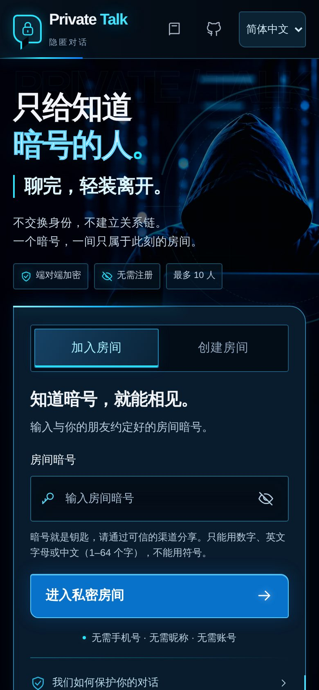
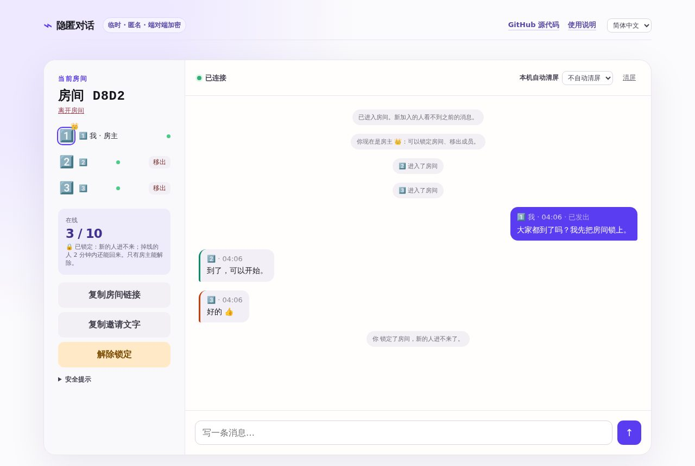
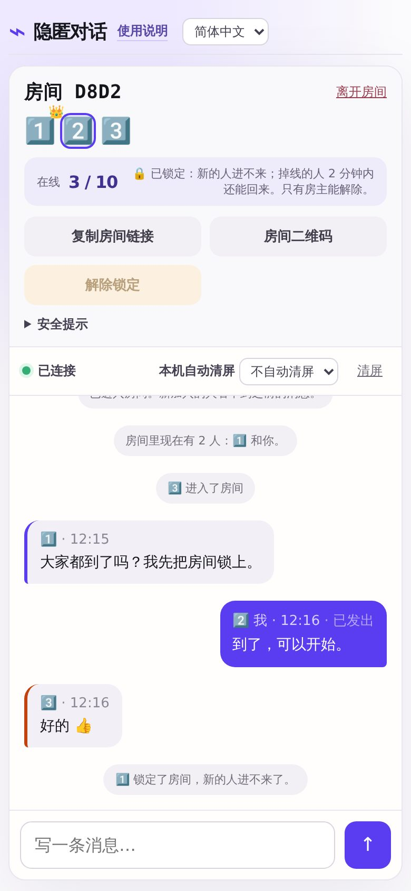
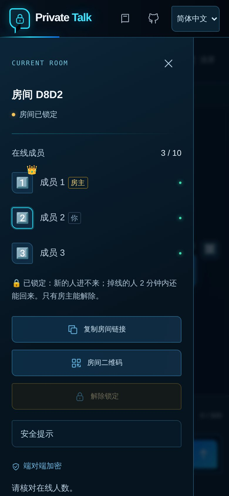
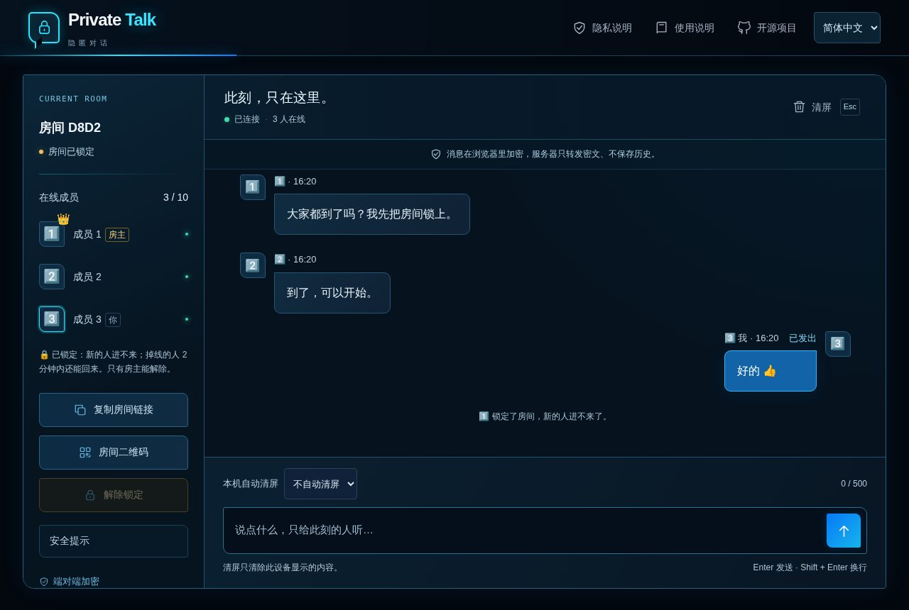
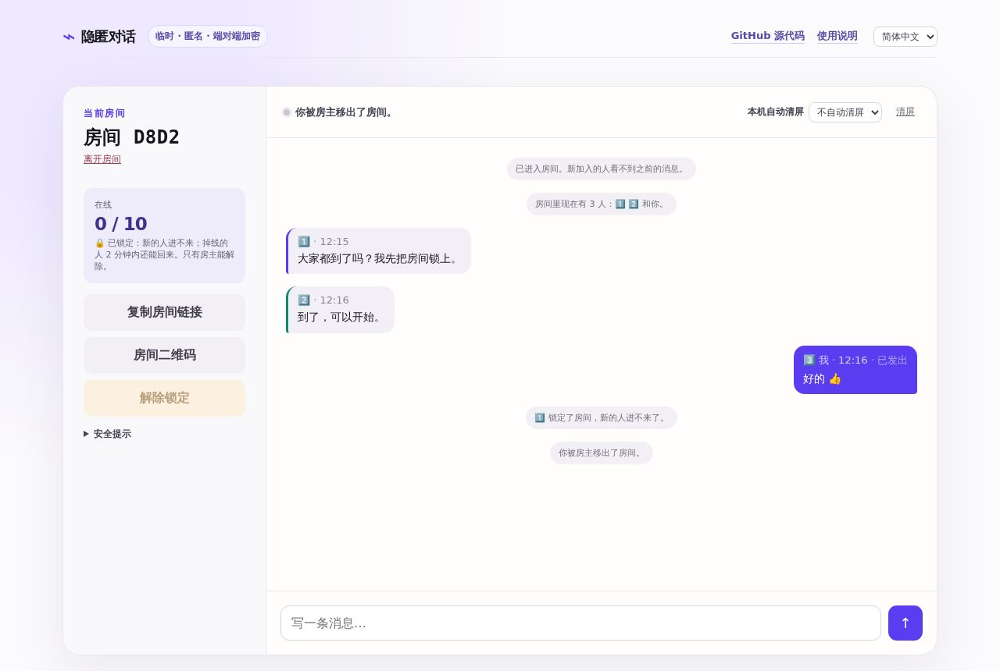
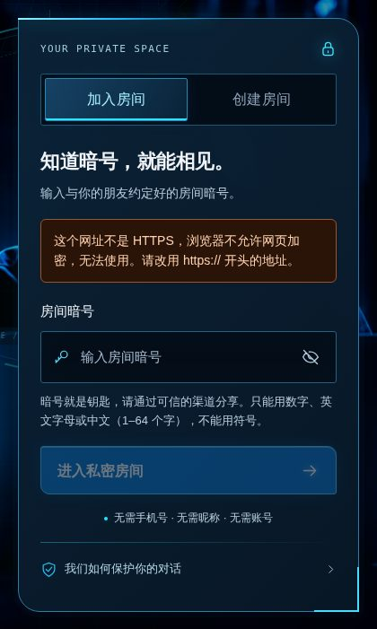

# 用户使用手册

给所有使用者。不需要安装任何东西，也不需要账号、手机号或昵称。

下文用 `https://聊天网址` 表示你所用网站的地址：公开的是 `https://chat.freedom8964.com`；单位或局域网里由管理员告诉你，例如 `https://192.168.1.20:8443`。

## 需要下载什么

**什么都不用下载。** 用手机或电脑上已有的浏览器打开网址即可：

| 设备 | 推荐浏览器 |
| :--- | :--- |
| iPhone / iPad | Safari（iOS 16 或更新） |
| 安卓手机 | Chrome、Edge、Firefox |
| Windows / Mac / Linux 电脑 | Chrome、Edge、Firefox、Safari 的较新版本 |

建议用**无痕 / 隐私窗口**打开（原因见第 9 节）。

## 1. 认识首页

首页上有：

- **顶部右侧**：「隐私说明」（网页能保护什么、不能保护什么）、「使用说明」（本手册）、GitHub 源代码，以及语言选单（简体中文、繁體中文、English、Español、বাংলা、Русский、العربية、Kreyòl Ayisyen、한국어、اردو、Français、हिन्दी，只对这一次有效，不会保存）。
- **右边的卡片**，用来进入房间，有两个标签：
  - **加入房间**（默认）：输入别人告诉你的暗号。
  - **创建房间**：自动生成一个随机暗号（22 个字符）；「生成另一个暗号」可以再换一个。
- **房间暗号**输入框：输入的内容像密码一样显示成圆点，点右边的眼睛图标可以显示 / 隐藏。它不是密码框，浏览器不会提示你“保存密码”。
- **进入私密房间 / 创建私密房间**：用输入框里的暗号进入房间。暗号不合规（例如有符号）时，按钮下方会用文字说明原因。
- **我们如何保护你的对话**：打开隐私说明。
- 往下滚动：三条特点，以及“直接用网址进入房间”和“自己部署一份”的说明。

手机上的首页是同样的内容，排成一列：

## 2. 暗号：它是什么、怎么选

**暗号就是房间的钥匙。** 同一个暗号进入同一个房间；消息也用暗号在你的浏览器里加密，服务器只看到看不懂的密文。

- **只能用**文字和数字，任何语言都行（中文、英文、西班牙文、俄文、阿拉伯文、孟加拉文等）。**不能用**符号、标点、空格、表情。
- 最短 1 个字，最长 64 个字。
- 英文区分大小写；`Abc` 和 `abc` 是两个房间。“龙”和“龍”也是两个房间。
- 全角字母数字（如 `ＡＢ１`）会自动当作半角（`AB1`）。

**怎么选暗号**：

| 用途 | 建议 |
| :--- | :--- |
| 重要、私密的谈话 | 用首页**随机生成**的暗号，别人不可能猜中 |
| 只聊几句闲话、方便口头告诉对方 | 可以自己起，但越长越好（12 个字以上）；短暗号进入后会有提醒 |
| 绝对不要 | 生日、名字、手机号、常见词语：这些很容易被猜中 |

> 暗号永久有效：所有人离开后房间就消失，但以后任何人用同一个暗号打开，会得到一个**新的空房间**。以前的消息不会回来。

## 3. 进入房间的三种方法

1. **收到了链接**：直接点开（或复制到浏览器地址栏打开），就进入了那个房间。
2. **从首页开房间**：打开 `https://聊天网址`，点「创建房间」标签，再点「创建私密房间」（用自动生成的暗号）；或者在「加入房间」里输入约定好的暗号，点「进入私密房间」。
3. **直接输入网址**：在地址栏输入 `https://聊天网址/#暗号`，回车。例如 `https://chat.freedom8964.com/#周五咖啡2026`。

进入时会显示“正在生成密钥…”，手机上可能要一两秒。进入后，地址栏里的暗号会立刻被抹掉，屏幕上也不会显示暗号。

## 4. 认识房间

**左边的房间栏**（手机上收在抽屉里，点左下角「房间」按钮或左上角的人形图标打开）：

- **房间 D8D2**：4 位房间代号，由暗号算出。和对方核对代号一样，说明你们在同一个房间、暗号没打错。它只用来发现输错，**不能证明对方是谁**。
- **房间开放中 / 房间已锁定**：锁定状态。
- **在线成员 3 / 25**：现在的人数和上限。
- **成员列表**：每个人是一个编号 1️⃣～🔟，第 11 位起是 #11～#25（“成员 1”就是 1️⃣）。超过 10 人时名单变紧凑，侧栏可以上下滚动。头像上带 👑、名字旁标着「房主」的是**房主**；标着「你」的是你自己；半透明的是掉线中的人。
- **🔐 前向保密已启用 · 安全码 12345 67890 12345 67890**（在成员列表下面）：说明这次对话用的是一次性钥匙，每条消息都有发送者的签名，以后就算暗号泄露，也解不开现在说的话；有人离开，大家自动换钥匙。后面跟着「**⚛️ 抗量子**」时，钥匙里还加了抗量子算法，将来有了量子计算机也解不开今天录下的内容；显示「有成员用旧版，未启用抗量子」时，请没升级的人升级（对话照常，只是少了这一层）。
  - **核对安全码**：通过电话或当面，和每个人念一遍这 20 位数字，一样就说明中间没有人被调包。不要在房间里互发安全码：被调包时它也会被调包。核对完点「**我已核对安全码**」，这里变成 ✅ 已核对。有人进出时安全码会变，✅ 自动取消，要重新核对。
  - 提示「**某人的签名密钥变了，但他没有离开房间**」时要警惕：可能有人冒充他，请重新核对。
  - **⛔ 有成员用旧版本，严格模式下暂停收发**：房间里有人用的是旧版本（例如没升级的 App），或服务器是旧版本。默认的严格模式下，你的消息不会发出（会提示并留在输入框里），旧版本发来的消息也不显示。请对方升级；确实需要和旧版本说话，可以勾选下方「**允许旧版本**」，只对这次访问有效，和旧版本之间的消息没有签名、可能也没有前向保密。
- **复制房间链接** / **房间二维码** / **锁定房间**（见第 5、6 节）。
- **安全提示**：点开有 5 条使用提醒。
- **离开房间**：退出，会先问一句“结束这次对话？”，点「离开房间」确认（见第 8 节）。
- 手机上多一个「返回聊天」，关掉抽屉回到对话。

**右边的对话区**：

- **已连接 · 3 人在线**：连接状态和人数。断线时显示“正在重新连接…”。
- **清屏**：立即清空**你这台设备**的屏幕和输入框（快捷键 Esc；如果开着弹窗或抽屉，第一下 Esc 先把它们关掉）。
- **紧急离开**（红色 ✕，手机上只有图标）：不用确认，立即离开房间、页面变成一片空白，并让浏览器清除本站数据。电脑上连按两次 Esc 也一样。想回来就刷新页面重新进房。
- 切到别的标签页或别的 App 时，聊天内容会自动模糊，回来就恢复。
- 中间是消息。居中的小字是系统提示（谁进来、谁离开、锁定等）。
- 底部：**本机自动清屏**（可选 1 / 5 / 30 分钟后，把**你这台设备**屏幕上的旧消息删掉）、字数（如 0 / 500）、输入框和发送按钮。

手机上的房间（成员和按钮在抽屉里）：

点「房间」打开抽屉：

## 5. 邀请别人

- **复制房间链接**：复制 `https://聊天网址/#暗号`。
- **房间二维码**：弹出一个二维码，对方用手机自带相机一扫就能进房（不建议用微信、QQ 等扫：会用它们的内置浏览器打开，链接会经过它们）。适合面对面拉人进房，免去把链接发到别的聊天软件里留下记录。
  - 二维码在你自己的浏览器里生成，不经过任何在线服务。
  - 二维码里就是房间链接（含暗号），**不要截图、不要转发**；点「关闭」、点二维码外面或按 Esc 即可收起。

**发送时注意**：

- 链接里就是暗号，**谁拿到链接谁就能进来**。
- 用当面、Signal、加密邮件等可信方式发送。不要用微信、QQ 等会被审查或保存记录的软件。
- 发完后清空剪贴板（随便复制一段无关的文字即可）。

## 6. 房主：锁定房间、移出成员

**谁是房主**：最早进入、并且一直在房间里的人。房主旁边有 👑。房主离开或掉线后，**下一位最早进入的人自动接任**；掉线后回来的人排到最后。

**只有房主能**：

- **锁定房间**：人到齐后点「锁定房间」。之后新的人拿到链接也进不来；房间里的人掉线 2 分钟内还能回来。再点一次「解除锁定」。
- **移出成员**：在成员列表里点某人旁边的「移出」。那个人立刻被断开，屏幕上显示“你被房主移出了房间”。

**要让被移出的人回不来，先锁定房间再移出。** 如果房间没锁，他拿着链接还能作为新成员再进来。

其他成员的「锁定房间」按钮是灰色的，鼠标停在上面会提示谁是房主：

被移出的人看到的画面：

## 7. 发消息

- 在底部输入框打字，按 Enter 或点发送按钮（→）发送；**Shift + Enter 换行**。用中文输入法选字时的回车不会发送。
- **每人可以连发 3 条，之后平均每 6 秒一条**，用完时发送按钮会倒数，输入框下方也会写“请稍等，几秒后可以发送”。
- **每条最多 500 字**。输入框上方显示已写的字数（如 120 / 500），超过时会提示删减。
- **公开桌（2.20 起，2.21 升级为玩法目录）**：首页的「🎲 快速找一桌」可以和陌生人玩：所有玩法平铺展示（通栏横幅卡片），上面写清玩法名称、人数、一句话说明和当前等待人数；狼人杀按人数分层，点开可选具体板子。点一个玩法卡片，有人在等就直接坐下，没人就开一张该玩法的新公开桌（不需要二次确认）。首页的「正在等人的公开桌」列出所有在等人的桌子和玩法名，点「坐下」加入。人人数固定的玩法（狼人杀板子）坐满自动开局；人数可变的玩法（如骗子骰、暗号潜伏）在达到最低人数后每人可点「准备」，全员准备、坐满或 45 秒倒计时结束即开局。**公开桌任何人都能进来，服务器也能看到那里的聊天和牌局，不要在公开桌说私密的事**；私密房间（输入暗号的房间）永远不会出现在大厅里。公开桌可以玩狼人杀、暗号潜伏、骗子骰、密约交易所、秘密任务。**公开桌的狼人杀由服务器当法官**（发身份、收夜里的行动和投票、私下告诉每个人该知道的事），没有哪个玩家的页面知道别人的身份；板子按人数自动选。离线局域网版和安卓 App 里没有大厅。
- **房间内选游戏与换游戏表决（2.21 起）**：进入房间后，侧栏为平铺的玩法卡片列表，自动把当前在场人数能玩的排在前面，人数不够的灰色显示并写明“还差 N 人”，点卡片直接开局（无需二次点击）。在游戏进行中，玩家可以随时点其他玩法卡片发起「提议换成该游戏」，或点面板上的「提议结束本局」；所有在场玩家有 30 秒表决时间，当 ≥80%（向上取整）玩家同意时，当前局提前结束，并由发起人开启新玩法（公开桌换玩法会自动同步至大厅列表）。表决和准备状态均为端到端加密的游戏事件，不经过服务器。一局结束后的「再来一局」旁边也提供「换个游戏」入口。
- **游戏规则说明**：侧栏的「📖 游戏规则」和游戏面板上的「📖 规则」可以随时查看每个游戏、以及狼人杀每个板子的详细规则（板子的牌、玩法要点、每个身份的技能）。开局按钮是灰色时，按钮下方会写明原因：人数不合适（列出每个游戏需要几人）、房间里正在进行一局，或有人还不是最新版。手机上从侧栏开局后，侧栏会自动收起，露出游戏面板。
- **游戏通用规则**：一个房间同一时间只能进行一局游戏；游戏进行中才进房间的人会看到提示，等这局结束后才能开新局，也不会被拉进正在进行的这局。「结束本局」要在几秒内连点两次才生效，防止误触。游戏里的每一步操作都是一条加密消息，和聊天共用发送额度（连发 3 条后每 6 秒 1 条），所以玩游戏时发聊天可能要等几秒，输入框下方会说明原因。游戏面板里的输入框（纸条、密码、猜词）和聊天输入框一样，清屏、离开房间时都会清空。
- **玩「🕵️ 暗号潜伏」**（4–8 人、大家都是最新版时）：在侧栏点「开一局暗号潜伏」。大部分人拿到同一个词，一个潜伏者拿到相近的词，谁也不知道自己是哪边。点一下或按住「看我的词」查看自己的词（再点一下、松手或 8 秒后盖住）；轮到你时发一条消息描述它，别直接说出来，每人 45 秒；描述完自由讨论 60 秒，然后点编号投票，30 秒内投完。票最多的人出局，平票没人出局；选票先加密锁定，所有人投完再一起亮出。出局的人会亮出他的牌。投出潜伏者，其他人赢；只剩两个人时两人亮牌，潜伏者还在就潜伏者赢。结束时所有人亮牌，公布潜伏者和两个词。**没有庄家**（2.20 起）：开局后大家的页面先轮流加密、洗牌、发牌（约 10–20 秒），谁也不知道潜伏者是谁，开局的人也不知道。开局的人可以随时「结束本局」；开局的人离开，本局作废。
- **玩「🔐 密电逃脱」**（2–8 人、大家都是最新版时）：在侧栏点「开一局密电逃脱」。大家是一队，要连开 3 道密码锁（3 位、4 位、5 位数字，各位互不相同，限时 3、4、5 分钟）。每道锁的线索（例如「第 2 位是奇数」「密码里没有 7」）分给了不同的人，谁也不能单独解开，必须在聊天里把线索说出来、一起推理。点一下或按住「看我的密电」查看自己的线索；在面板的框里输入密码点「开锁」（各位数字互不相同，有重复数字的密码不会提交，也不扣机会），每次只能有一个人在试，试的密码大家都看得到。猜错 3 次警报响，失败；超时也失败。有人中途离开，他的线索会公开，点按钮就能看到。结束时公布全部密码。
- **玩「🤝 密约交易所」**（2–8 人、大家都是最新版时）：在侧栏点「开一局密约交易所」。共 5 轮，每轮两两配对（人数为单数时有一人轮空，轮流来）。每人在 60 秒内暗中点「守约」或「背叛」：都守约各得 3 分；一方背叛，背叛者 5 分、守约者 0 分；都背叛各得 1 分。可以在面板里给对手「递纸条」，只有对方看得到（别人只看到你递了纸条）；也可以在聊天里公开谈判。两人都锁定后自动一起亮牌，谁也不能偷看或反悔。5 轮后总分最高者赢，并公布每人背叛了几次。
- **玩「🎯 秘密任务」**（3–8 人、大家都是最新版时）：在侧栏点「开一局秘密任务」，限时 8 分钟。每人暗中抽到一个任务：让某个人在聊天里说出某个词（点一下或按住「看我的任务」查看）。在聊天里自然地引导对方，他一说出这个词（中文只要句子里含有就算，英文要是完整的单词），你的页面会自动完成任务，得 3 分，再抽新任务；自己说出来不算。觉得谁在套话，可以在面板里选他、填你猜的词、点「揭穿」：猜中得 2 分，他的任务作废；猜错扣 1 分。时间到总分最高者赢，并公布每人最后的任务。
- **玩「🎲 骗子骰」**（2–8 人、大家都是最新版时）：在侧栏点「开一局骗子骰」，可以先勾选「1 点万能」（Perudo 规则）。每人 5 颗骰子，只有自己看得到（点一下或按住「看我的骰子」，屏幕上也会私下显示一次）。轮流叫「全场至少有几个几点」，后面的人要叫得更大（个数更多，或个数相同、点数更大），每人 45 秒；不信就点「开！」，大家亮骰子数一数：够数，开的人输一颗骰子；不够，叫的人输一颗。输的人先叫下一轮，骰子输光出局，最后有骰子的人赢。谁也不能偷看或挑选骰子，开局的人也不能：每个页面先发加密承诺，所有人的随机数合起来才决定点数，亮骰时每个页面自己核对。
- **玩「🐺 狼人杀」**（6–12 人、大家都是最新版时）：在侧栏选好**板子**（只列出适合当前在线人数的），需要的话勾上「警长竞选」，选择**法官模式**（默认为「⚖️ 服务器（推荐，人人都能玩）」，也可选择「💻 开局者的页面」），再点「开一局狼人杀」。房间里在线的人全部参加；同一个人开着两个页面会占两个座位。服务器法官模式下，服务器负责发牌与裁决，开局的人和大家一样正常拿暗牌参与游戏，开局者中途离开游戏继续运行；聊天发言仍然是端对端加密。开局者页面法官模式下，技术上开局者浏览器运行裁判程序，持有所有身份。
  - **圆桌界面**：开局后进入仿饭局对局版式的「圆桌」：座位分为左右两列对称竖排（如 7 人局左 4 右 3），中央为法官播报「舞台」，大字播报当前阶段台词（天黑请闭眼、狼人睁眼、天亮了、谁发言、开始投票、谁被放逐等），并带倒计时和淡入动效。
  - **纯 CSS 昼夜动效**：夜晚自动换成深蓝夜空与星月背景，白天切换为明亮雅致主题，0.6 秒平滑过渡（支持 `prefers-reduced-motion` 静止偏好）。
  - **圆桌版式与点头像行动**：左右两列横向座位条（左列头像居外、名字朝内；右列镜像），头像大号（≥52px）且左上角带大号座位号，垂直均分屏幕高度。夜晚轮到行动时，可选头像发光跳动，中央舞台提示「请点头像选择要刀/查验/守护的人」；点击头像弹出确认框（如「刀 5 号？[确定][取消]」），触摸与鼠标点击均完美支持；女巫拥有药水操作条（救人/毒人/不用药）。右上角保留「列表模式 / 圆桌模式」切换。
  - **投票打勾与票型公示**：放逐投票与警长竞选阶段，已投票的玩家头像上覆盖显示醒目绿色打勾（夜间行动不打勾防泄露身份）；投票结束后中央舞台展示票型汇总（如「1 号、4 号 → 3 号」）并清空打勾。
  - **白天发言与座位气泡**：轮到某人发言时头像显示呼吸光环与倒计时，聊天区发言会以气泡浮现在座位旁（6 秒后淡出）；轮到自己可点「结束发言（过）」；手机端底部精简输入框与发送按钮整齐同行。
  - **防窥身份牌与原创矢量图标**：圆桌左下角常驻小牌（背面花纹），点击翻开展开大牌，查看身份说明、技能与私下信息。19 种角色全部配备风格统一的原创内联 SVG 矢量图标。
  - **游戏复盘（结算摊牌）**：对局结束后展示复盘大卡，左右两列座位翻开真实身份（含角色图标、缩写角标与全称），出局者加盖红色「出局」印章；中间按天数与昼夜时间线展示完整复盘（预言家查验及结果、狼刀、女巫救/毒、守卫、死亡讯息、投票票型与放逐结果等）；顶部胜负横幅，底部设有「再来一局」「换个游戏」「回到聊天」按钮。
  - **板子**：6 人新手局；7、8、9、10、11 人预女猎（9 人还有预女守、10 人还有预女猎白）；8 人狼猎对决（4 狼 4 猎人）；12 人有标准预女猎白、预女猎守、狼王守卫、白狼王、隐狼、狼美人、骑士、石像鬼、药剂师、丘比特、摄梦人、魔术师、大灰狼、盗贼共 14 种，默认带警长。
  - **规则取舍**（各平台不一，这里取最常见的）：屠边；平票没人出局；女巫一晚只能用一瓶药，只有第一夜能自救；同守同救算死；守卫不能连续两晚守同一人；猎人、狼王被刀或被放逐能开枪，被毒死、殉情不能开枪；被开枪带走的猎人也能接着开枪；白痴被放逐时翻牌免死，之后不能投票；白狼王自爆带走一人后立即入夜；骑士决斗到狼则立即入夜，决斗到好人则骑士出局、白天继续；隐狼和石像鬼不在狼队里，狼队全死后由它们刀人；狼美人每晚魅惑一人，不能连续两晚同一人，她死时被魅惑者殉情；大灰狼的猎物白天被放逐，当晚狼队刀两人；摄梦人让一人梦游，梦游者当晚不受伤害，连续两晚梦游同一人会死，摄梦人出局时梦游者一起死；魔术师交换两人，当晚指向他们的刀、查验、守护、毒都对调；丘比特第一夜连情侣，一方死另一方殉情，一人一狼时情侣和丘比特成为第三方，要活到最后；盗贼第一夜从两张多余的牌里选一张，有狼人牌必须选狼人牌；警长出局时可以移交或撕掉警徽，平票没有警长。
- **发图片**：点输入框左边的图片按钮，选一张图。图片会在你的浏览器里缩小，并去掉拍摄地点（GPS）、手机型号、拍摄时间等信息，再加密发出；服务器看不到内容。点图片可以全屏看，再点一下退出。图片只在屏幕上，清屏或离开就没了。每分钟最多 6 张。安卓 App 用系统的图片选择器，不需要存储权限。
- 自己的消息出现在右边，带“**已发出**”：表示服务器已经转发。几秒内会变成“**已送达 2/3**”（发送时在场的 3 个人里，2 个人的页面已经收到并解开）或“**✓ 全部送达**”。回执只说明对方页面收到了，**不代表对方已经看过**；一直停在 2/3，说明有人掉线或网络不好。
- 8 秒内没有收到服务器确认，消息会放回输入框，并提示可能没发出去，可以再发。
- 消息里的网址、代码都按纯文字显示，不会被执行。

**新加入的人看不到之前的消息**；断线期间别人发的消息也收不到。

## 8. 离开房间

- 点「离开房间」，在弹出的确认框里再点「离开房间」（点「继续对话」或按 Esc 取消）；或者直接关闭网页 / 标签页。手机上「离开房间」在「房间」抽屉的最下面。
- 关闭网页时，页面会请浏览器清除本站的缓存和数据，并丢掉暗号、密钥和消息。
- 所有人都离开后，房间就消失了。

## 9. 安全习惯

| 习惯 | 为什么 |
| :--- | :--- |
| 用无痕 / 隐私窗口 | 地址栏里带暗号的网址会留在浏览器历史里，网页删不掉 |
| 不用带“云输入”的输入法（搜狗、百度等的云输入） | 它们会把你打的字传到自己的服务器，网页挡不住 |
| 用随机暗号 | 短暗号可能被猜中，别人进来就能看到消息 |
| 人到齐后让房主锁定 | 防止链接被转发后有人进来 |
| 和对方核对房间代号 | 确认在同一个房间 |
| 人到齐后核对安全码 | 确认没有人夹在你们中间（暗号泄露又遇上服务器作恶时才会发生） |
| 别人能看到你屏幕时按 Esc | 立即清屏 |
| 打开系统的“自动设置时间” | 消息按本机时间核对，时间差超过 10 分钟会收不到或发不出 |

**这个工具做不到的**：

- 不能阻止对方截图、拍照、复制。
- 不能证明房间里的人是谁：编号只是座位号。
- 服务器看不到内容，但能看到你的 IP 地址和上线时间。要隐藏 IP，请配合可信的 VPN。
- 设备本身被监控（恶意软件、被人拿到手机）时，网页保护不了。

## 10. 内网地址的证书提示

在单位或局域网里使用时，浏览器第一次可能显示“您的连接不是私密连接”（Chrome / Edge）、“警告：潜在的安全风险”（Firefox）或“此连接非私人连接”（Safari）。

这是因为内网服务器的证书是它自己签发的，不是公网证书机构签发的。处理方法：

1. **核对地址**：确认地址和管理员告诉你的完全一样。
2. **继续访问**：
   - Chrome / Edge：点「高级」→「继续前往 …（不安全）」。
   - Firefox：点「高级…」→「接受风险并继续」。
   - Safari：点「显示详细信息」→「访问此网站」→ 再点「访问网站」确认。
3. **长期使用**：请管理员给你 `ca.crt` 证书文件，按[局域网手册](lan.md#5-让设备不再提示证书)安装，以后就不再提示。

**在互联网上的公开网站（例如 chat.freedom8964.com）出现证书提示，不要继续**，那可能是有人在冒充网站。

## 11. 用 http:// 打开时

如果网址是 `http://` 开头（不是 https），卡片里会显示橙色提示，「进入私密房间」按钮也不能点：

改用 `https://` 开头的地址即可。如果管理员只给了 http 地址，请他按部署手册开启 HTTPS。

## 12. 系统提示一览

| 提示 | 意思 | 怎么办 |
| :--- | :--- | :--- |
| 你现在是房主 👑 | 你是最早进来的人 | 人到齐后可以锁定房间 |
| X 现在是房主 👑 | 原房主离开了，X 接任 | — |
| 房间里现在有 N 人 | 你进来时房间里已有的人 | — |
| X 掉线了，2 分钟内回来仍是 X | X 的网络断了 | 等一会儿 |
| 已重新连接，你还是 X | 你的网络断了又连上了 | 断线期间的消息收不到 |
| 已重新连接，你现在是 Y | 你掉线超过 2 分钟，或所有人都断开过，房间重新开始 | 锁定会解除，请房主重新锁定 |
| 房间已满（25 人） | 人满了 | 等有人离开，或开新房间 |
| 房间已锁定，进不去 | 房主锁定了房间 | 请房主解除锁定 |
| 你被房主移出了房间 | 房主把你移出了 | — |
| 只有房主 X 能这样做 | 你不是房主 | 请房主操作 |
| 进入次数太多，请稍后再试 | 同一网络一分钟内进房太多次 | 等一分钟 |
| 每 6 秒只能发一条 | 连发 3 条后发太快了 | 等倒数结束，消息已放回输入框 |
| 收到无法解密或来源对不上的消息，已忽略 | 有人发了错误或伪造的数据，或设备时间不准 | 检查本机时间是否正确 |
| 这台设备的时间和服务器相差约 N 分钟 | 本机时间不准 | 打开系统的“自动设置时间” |
| 提醒：这是自己设定的短暗号 | 暗号太短 | 重要谈话换随机暗号 |
| 这个页面版本太旧或暗号不对 | 网站更新了，或页面出错 | 刷新页面重新进入 |

更多问题见 [故障排查](troubleshooting.md)。
